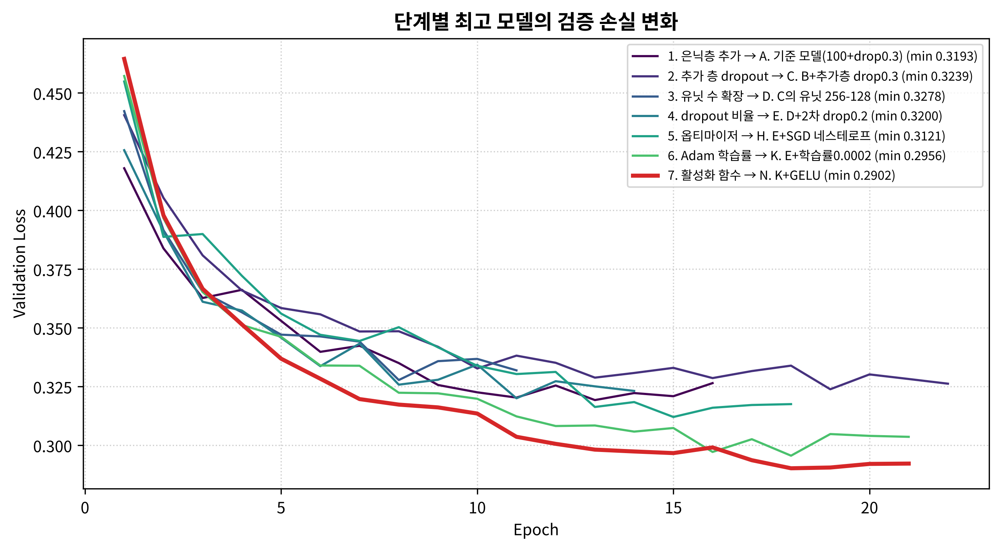

# Fashion MNIST 모델 개선 실험

은닉층이 하나인 신경망에 은닉층을 추가하고, dropout, 유닛 수, 옵티마이저, 학습률, 활성화 함수를 차례로 바꾸며 Fashion MNIST 분류 성능을 비교한 실험입니다.

## 결과 요약

14개 실험 중 **GELU 활성화 함수와 학습률 0.0002를 쓴 256-128 구조**의 검증 손실이 가장 낮았습니다.

| 모델 | 구조 | 검증 손실 | 검증 정확도 | 테스트 손실 | 테스트 정확도 | 파라미터 수 |
|---|---|---:|---:|---:|---:|---:|
| 기준 모델 (A) | 100 | 0.3193 | 88.38% | 0.3507 | 87.75% | 79,510 |
| 최종 모델 (N) | 256-128 | 0.2902 | 89.44% | 0.3161 | 88.72% | 235,146 |



## 실험 방법

단계마다 조건을 하나만 바꾸고, 가장 좋은 설정을 다음 단계로 넘겼습니다.

| 단계 | 실험 | 바꾼 조건 | 최고 검증 손실 |
|---|---|---|---:|
| 1. 은닉층 추가 | A, B | 기준 모델 → 은닉층(50) 추가 | 0.3193 (A) |
| 2. 추가 층 dropout | C | 추가 층에 dropout 0.3 | 0.3239 (C) |
| 3. 유닛 수 확장 | D | 100-50 → 256-128 | 0.3278 (D) |
| 4. dropout 비율 | E, F | 2차 층 0.2, 0.1 | 0.3200 (E) |
| 5. 옵티마이저 | G, H | RMSprop, SGD 네스테로프 | 0.3121 (H) |
| 6. Adam 학습률 | I, J, K | 0.0005, 0.0003, 0.0002 | 0.2956 (K) |
| 7. 활성화 함수 | L, M, N | ELU, Swish, GELU | 0.2902 (N) |

- **데이터:** 훈련 세트 60,000개 중 20%를 검증 세트로 분리하고, 픽셀 값을 0~1로 정규화했습니다.
- **공통 설정:** 최대 50 에포크, 시드 42, `EarlyStopping(patience=3)`, `ModelCheckpoint`로 최고 모델 저장
- **모델 선택:** 검증 손실로 고르고, 테스트 세트는 마지막 비교에만 사용했습니다.

## 알게 된 점

- 은닉층을 추가하는 것만으로는 성능이 좋아지지 않았습니다. B의 검증 손실은 기준 모델보다 조금 높았습니다.
- 가장 큰 개선은 학습률에서 나왔습니다. 같은 구조에서 Adam 학습률을 0.001에서 0.0002로 낮추자 검증 손실이 0.3200에서 0.2956으로 줄었습니다.
- 활성화 함수는 GELU가 ReLU보다 좋았고, Swish는 비슷했으며, ELU는 나빴습니다.

전체 결과는 [results/results.csv](results/results.csv)와 아래 그림에서 볼 수 있습니다.

- [실험별 성능 비교표](results/fig1_results_table.png)
- [모든 실험의 손실 곡선](results/fig2_loss_all.png)
- [최종 모델의 학습 곡선](results/fig4_final_curves.png)

## 실행 방법

```bash
pip install -r requirements.txt
jupyter notebook fashion_mnist_model_improvement.ipynb
```

`results/histories.json`에는 학습 기록이 있지만 용량이 큰 모델 파일은 저장소에 없습니다. 노트북을 처음 실행하면 모델을 다시 학습하며, 결과는 실행 환경에 따라 조금 달라질 수 있습니다.

## 참고 자료

기준 모델과 일부 코드는 박해선, 「혼자 공부하는 머신러닝+딥러닝」 7장([코드 저장소](https://github.com/rickiepark/hg-mldl2))을 참고했습니다. 노트북에서 해당 부분은 `[기준 코드]`로 표시했습니다.
